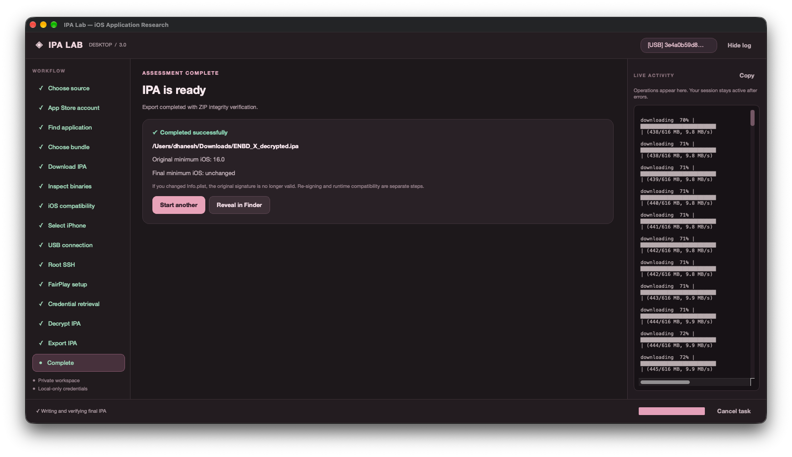

# IPA Lab Desktop v3.0.0



**A macOS desktop IPA research workflow — inspired by the compact, dark, warm-color user experience of Impactor v2.7.2.** This is an independent tool; it does not include Impactor's signing or sideloading backend and is not affiliated with Impactor.

Unlike IPA Lab v2's full-screen TUI, v3 opens an actual, resizable **Qt desktop window** (PySide6) with mouse controls, native macOS title bar, persistent workflow navigation, an optional activity panel, browse dialogs, a step progress bar, and nonblocking background jobs.

## Requirements

- macOS with Homebrew and Xcode (iPhoneOS SDK)
- Python 3.11–3.13 (PySide6 `>=6.8,<7`, installed automatically by the launcher)
- A paired, authorized, jailbroken iPhone with OpenSSH

## Start with one command

```bash
cd IPA-Lab-Desktop-v3.0.0
python3 ipa_lab.py
```

Or on macOS, double-click **`Launch IPA Lab.command`**.

On first use, the launcher asks before creating `.venv` and installing PySide6. If your default Python is **3.15**, the launcher searches for compatible Python 3.13/3.12/3.11; with approval it can install `python@3.13` through Homebrew. It will not silently alter the system Python.

To reuse your existing FairPlay checkout:

```bash
python3 ipa_lab.py \
  --fairplay-repo "/Volumes/mrd-ssd/Projects/iOS Pentesting/Projects/EI+/IPAChecks/fairplay-decrypt"
```

Open an IPA immediately:

```bash
python3 ipa_lab.py --local-ipa "$HOME/Downloads/Liv_X.ipa" \
  --fairplay-repo "/path/to/fairplay-decrypt"
```

## Desktop experience

- **Impactor-inspired style:** warm charcoal/plum window, soft rose action buttons, compact toolbar and selected device badge. No third-party logos are copied.
- **Responsive:** at wide widths, three regions (steps, task, activity); at medium widths the activity panel hides, available from **Activity**; at compact widths the step rail hides and log opens in a separate dialog. Resizable window down to 780×585.
- **Mouse-first:** clickable actions and rows, native browse dialogs, double-click app selection, drag/drop `.ipa`, editable paths, hover and keyboard shortcuts.
- **Background work:** slow `ipatool`, `otool`, `idevice_id`, `iproxy`, SSH, FairPlay `make`, credential retrieval and decryption are managed without freezing the window.
- **Recovery in place:** failures show a visible alert with Retry plus contextual actions. No automatic loop on side effects such as downloading or modifying files. Safe device discovery and free-port checks can auto-wait.
- **Shortcuts:** `Ctrl+O` open IPA, `Ctrl+R` retry, `Ctrl+L` activity.

## Workflow

1. macOS and required tool checks. If missing packages are detected, **ask approval** for `brew install`.
2. App Store authentication via **ipatool auth login** in macOS Terminal; IPA Lab never intercepts passwords.
3. Search app names (including spaces) with a selectable 1–50 result limit.
4. Choose the exact bundle identifier from a list.
5. Download the IPA, choosing a destination and refusing to overwrite an existing file; safely reuse or generate a unique filename.
6. Inspect `Info.plist` and each Mach-O executable / framework using `otool -l`; report `cryptid` and encrypted bytes.
7. Optionally change **MinimumOSVersion to exactly `15.0`** at export time (no arbitrary version editing).
8. Enumerate USB iPhones; choose the intended jailbroken, trusted device.
9. Manage an `iproxy` tunnel (default localhost `2222` → device port `22`) as a background process; recover from busy ports.
10. Verify root SSH public-key authentication. With permission, open Terminal for interactive **root** key setup or mobile+existing sudo, then recheck.
11. Use an existing fairplay-decrypt clone or clone upstream with consent. Create Python venv / build iOS components with consent.
12. Retrieve the 16-byte credential using the selected IPA and iPhone (when supported by the upstream retriever).
13. Run `decrypt.py` on the IPA and monitor logs.
14. Select export destination (works on exFAT external SSD), optionally apply 15.0 plist change, validate ZIP and retain original.
15. Show export path and allow a new session or reveal in Finder.

## Important limitations and security

- **Requires macOS** with Homebrew, full Xcode/iPhoneOS SDK for the FairPlay retrieval build, a paired authorized jailbroken iPhone with OpenSSH, a valid App Store license, and the upstream `EthanArbuckle/fairplay-decrypt` code. Device login/configuration follows existing jailbreak privileges.
- **Does not change the iPhone root password** (in particular, it never makes the root password literally `root`). It installs an approved public key using existing root login or authorized `mobile` sudo. Root setup uses Terminal because password prompts must remain native and must not be handled by the GUI.
- Credentials are stored only in a private temporary directory and deleted on normal exit. Abrupt system crashes/forced kills may require checking your OS temporary directory manually.
- Editing `MinimumOSVersion` **does not make an iOS 16+ binary compatible with iOS 15** and invalidates the original code signature. Re-signing, sideloading, and runtime compatibility testing are separate tasks.
- For the upstream `decrypt.py` hard-link issue on exFAT, working decryption happens under the Mac's temporary area (normally APFS), and the final IPA is copied using exclusive-create semantics to an external drive. If your system TMPDIR is itself on exFAT, use a macOS-native temporary directory.
- The GUI is Python/Qt, not a prebuilt `.app`/`.dmg`. Building/distributing an app bundle must be done on macOS. The double-clickable `.command` launcher is included.
- Work only on devices and software you are authorized to test.

## Tests

On any Python 3.10+ host:

```bash
python3 -m unittest discover -s tests -v
```

Offline tests cover source parsing, ZIP path safety, plist rewriting, exclusive output behavior, SSH checks and static Qt/recovery contract checks. **They do not exercise a live Qt window or real iPhone**; those must be tested on a Mac with PySide6 installed.

## Files

```text
IPA-Lab-Desktop-v3.0.0/
├── ipa_lab.py                 # Single entrypoint, PySide6 bootstrap
├── Launch IPA Lab.command     # macOS double-click launcher
├── requirements.txt
├── ipalab/
│   ├── core.py                # Reused IPA Lab v2 workflow backend
│   ├── desktop.py             # Native Qt desktop GUI
│   └── theme.qss              # Impactor-inspired appearance
└── tests/test_ipa_lab.py
```

## Repository notes

`vendor/fairplay-decrypt` is a separate upstream checkout and is intentionally excluded from version control (see `.gitignore`). Clone it there or point to your own copy with `--fairplay-repo`. IPA files, credentials and output folders are also ignored so they are never committed.
